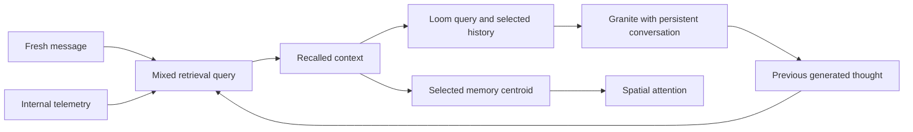

# Attention diagnosis and conditional context sections — 2026-10-10

The saved live run shows the current requests reaching Granite, followed by
answers about an older conversation. This investigation identifies several
concrete contributors and one broken topic measurement. It does not isolate a
single cause of the model's behavior. The change made here is context
presentation; there is no post-change live agent result or product score.

## Evidence and scope

The source run is the [normal-entrypoint live integration diagnostic](../2026-10-10-live-agent/README.md),
using this checkout, `main.py`, the local dashboard, Granite, RWKV/Habitus,
mRAG and all nine configured Loom lanes. Its manifest records the copied state,
configuration, hardware and inherited boundaries. That run did not establish
the intended non-tool motor pathway, and remains an unscored diagnostic.

[Trace analysis](trace-analysis.json) verifies all archived raw evidence hashes
and all 124 Helix / 100 MightyMem source hashes against the recorded composition.
For the two implementation files edited here, it uses the saved pre-edit copies.
Each of the four saved Loom packets matches an actual foreground request in the
provider trace. This is analysis of that recorded run, not a new model run.

## Step-by-step findings

1. **Input arrival is established.** All three fresh user requests occur in the
   actual foreground packets. The file sensing/read/write requests did not
   disappear before the provider call. No file action occurred in the recorded
   trial; that outcome is documented separately in its action receipts.

2. **An old topic appeared before the first user reply.** The initial pulse had
   no incoming events. Loom admitted four earlier assistant statements, and
   RWKV/cortex routing selected outward communication without an incoming
   speaker. Granite produced an unsolicited response addressing the old
   interlocutor and discussing the earlier inner-voice topic. The next pulse
   carried that output forward in both history and the retrieval trigger.
   Autonomous idle thought is part of Helix's design; this observation does not
   establish that idle pulses should be disabled.

3. **The retrieval query mixes sources.** `Preconscious._build_trigger_text`
   concatenates incoming events and the previous thought. On the greeting,
   the fresh event was 268 characters and the previous-thought contribution
   was 500. The recorded mRAG work order contains both, and its semantic heads
   include the old inner-voice topic. On the final request, eight queued
   context/stability events precede the user message; the recorded final mRAG
   work order classifies the request as a preference question. These are
   observed derived fields, not measurements of transformer attention.
   A multi-hop turn can retrieve more than once, so `last_stats` alone is not
   a complete account of all retrieval calls in that turn.

4. **History is presented through several paths.** The preconscious annotations
   originally shared the “New events” block with fresh input. Mindscape then
   passes that already-enriched packet, including recalled material and state,
   as Loom's retrieval query. Loom admits further earlier statements, while
   the persistent provider session also retains prior messages and replies.
   All four saved Loom packets contained only continuity entries: 4, 5, 7 and 9
   respectively. Each had `task_id=null`; task cognition was configured to
   observe and recorded intentions after generation. It did not supply an
   active task scope to this compiler.

5. **The topic tracker measures an empty key.** Habitus's dictionary paths use
   `target_node_id` and `path_node_ids`. `TopicalTracker.observe_turn` reads
   `target_concept_id`/`target` and `path_nodes`/`nodes` for dictionaries. It
   consequently accepts `""` as the node. Actual receipts on pulses 2–4 show
   `focus_topics=[""]`, zero drift, rising momentum, and familiarity rising
   from 0.45 to 0.765 to 0.9855. With activation concentrated on one empty key,
   cosine distance remains zero even when the requested topic changes.
   In addition, Mindscape calls the tracker before the current compile updates
   `graph_lane.paths`, so it receives the previous pulse's paths. This is a
   confirmed broken orientation signal, not proof that all RWKV focus is absent.
   Neither the schema nor timing was changed in this presentation step.

6. **Spatial attention follows retrieved memory when a centroid exists.**
   `SpatialMind.update_attention` explicitly uses the selected cluster centroid
   instead of blending the fresh incoming embedding in that branch. The saved
   preconscious results supply a centroid on all three user turns. This design
   can reinforce the retrieval-selected topic; the trace does not establish
   the size of its contribution to the wrong answers. Physics was not changed.

7. **Context accounting is a separate blocker.** Loom uses its regex counter
   for the current packet, while the foreground consumes system instructions
   and persistent history too. The greeting exhausted the selected 8,192-token
   context, but the two later action-request answers ended normally. Thus a
   cutoff explains the incomplete greeting, not the whole failure to follow
   requests. The log then skipped compression because four messages were “too
   short.” The system instruction's blanket private-monologue rule also
   conflicts with Mindscape's per-pulse outward-response guidance. These issues
   remain open.

| Recorded pulse | Foreground prompt tokens | Generated tokens | Stop reason |
|---|---:|---:|---|
| Idle startup | 2,114 | 470 | stop |
| Greeting | 7,822 | 370 | length |
| Feel files | 5,231 | 1,276 | stop |
| Open/write/read back | 7,257 | 842 | stop |

The observable feedback path is:

## Presentation change

`core/pulse_context.py` groups translated events by their outer form and omits
empty groups. It distinguishes messages received now, fresh sensations,
focused-work results/questions, reminders, other events, recalled context,
internal state, and ability awareness. Unknown events remain visible. Grouping
preserves event order within each source; the original timestamps remain.
Recalled sensory text stays in the historical section.

The existing omission of duplicate native tool-return payloads is retained;
those have their existing provider-history/preconscious route. That filter now
matches the outer tool event rather than suppressing a user message merely
because it quotes `Tool [...] returned:`. This does not repair the separate
Ollama tool-executor wiring identified in the live trial.

`core/mindscape_context.py` customizes native Loom rendering. Recalled human
statements and earlier unverified assistant statements get different headings.
Selected observation records receive a historical observation heading; the
upstream section order previously omitted that section. Source IDs, evidence
labels and complete entries are retained. Private thoughts remain governed by
the existing native evidence policy. Prior foreground turns already in provider
history are not copied into a new section on every pulse.

The adapter renders before native budget checks and packet hashing. It retains
the configured store, embedding provider, lanes, evidence policy and budget.
Different header costs can affect admission at the context boundary. The
existing enriched-input retrieval query also sees the pulse headings; this
change does not isolate retrieval from presentation. A regression check ensures
the new pulse headings alone do not trigger native historical/future detection.
The
subclass uses native full-render counting during admission instead of the base
class's incremental regex fast path; its cost on a large corpus is unmeasured.
It adds no cap, timeout, truncation, provider change or action-controller change.

## Verification and remaining work

`venv/bin/python -m unittest tests.test_pulse_context tests.test_mindscape_setup -v`
passed **25 implementation checks**: 12 presentation/provenance diagnostics and
13 existing setup checks. Syntax checks and `git diff --check` passed. Checks
include misleading quoted event markers, historical sensations, omitted empty
sections, preserved source labels and native counting of rendered headers.
The in-memory compiler checks are implementation diagnostics, not recall tests.

Formatting-only previews of all four recorded packets preserve every recorded
event, annotation and admitted entry. Full previews remain under
`/tmp/helix-attention-20261010-mox8f0hi`; their paths and hashes are in the trace
analysis. They do not rerun retrieval, model inference or actions and cannot
demonstrate improved behavior. The forensic script is retained there as
`inspect_saved_run.py`; pre-edit copies and hashes are in `before/` and
`before-sha256.json`.

The next distinct diagnostic targets are the tracker schema/timing, the sources
used to form retrieval queries, and whole-session context accounting. Any claim
of better attention or successful actions requires the declared full composition
through its normal entry point with new answer/action receipts. Header checks
do not satisfy that requirement.
